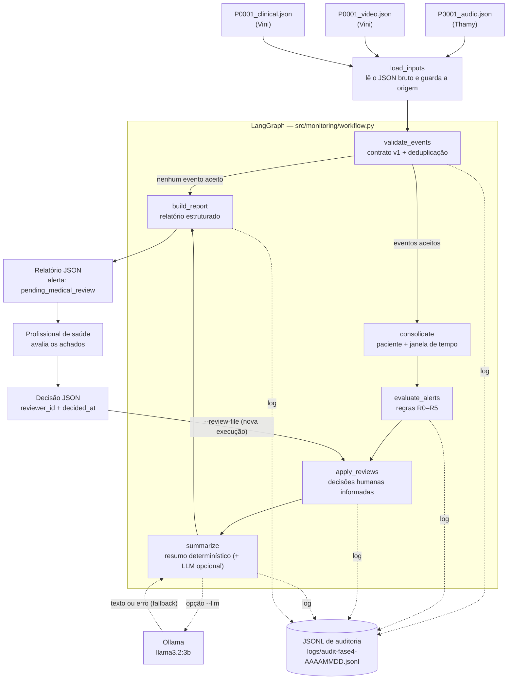

# Arquitetura da integração — Fase 4

Responsável: Paola (arquitetura e integração).
Módulos de origem: áudio (Thamy), vídeo e anomalias em dados clínicos (Vini).

> Protótipo com dados fictícios. Os resultados são **achados para avaliação profissional**,
> não diagnóstico nem conduta. Todo alerta nasce pendente de revisão médica.

Documentos relacionados:
[contrato de eventos v1](fase4_contrato_eventos_v1.md) ·
[regras de alerta](fase4_regras_alerta.md) ·
[JSON Schema](../schemas/event_v1.schema.json) ·
[exemplo de relatório](fase4_exemplo_relatorio_P0001.json)

## Visão geral



| Componente | Arquivo |
|---|---|
| Contrato v1 (Pydantic, fonte da verdade) | `src/contracts/event_v1.py` |
| Decisão de revisão | `src/contracts/review.py` |
| Grafo e CLI | `src/monitoring/workflow.py` |
| Nós do grafo | `src/monitoring/nodes.py` |
| Estado do grafo (`TypedDict`) | `src/monitoring/state.py` |
| Regras de prioridade | `src/monitoring/rules.py` |
| Resumo determinístico e Ollama | `src/monitoring/summarizer.py` |
| Auditoria JSONL | `src/monitoring/audit.py` |
| Conversor do áudio da Thamy (`audio_analysis` 1.0.0 → evento v1) | `modules/audio_thamy/to_monitoring_event.py` |

O desenho segue o padrão da Fase 3 (`src/graph/`): `StateGraph` com estado `TypedDict`, nós
em uma classe, aresta condicional, auditoria em JSONL e execução offline.

## 1. Validação e agrupamento

**Entrada.** `load_inputs` lê cada arquivo (ou todos os `*.json` de uma pasta) como texto
bruto, aceitando UTF-8 com BOM, e guarda o caminho em `origin`. A validação acontece dentro
do grafo, então um JSON malformado vira uma rejeição auditada, e não um erro de execução.

**`validate_events`**, para cada entrada:

1. Faz o parse do JSON. Se falhar, rejeita com `invalid_json`. Um arquivo pode trazer um
   objeto ou uma lista de eventos; os itens de uma lista recebem a origem `arquivo#índice`.
2. Valida o evento contra `MonitoringEventV1`: campos obrigatórios, fuso no `timestamp`,
   `event_type` e tipos de evidência compatíveis com o `module`, prefixo do `event_id` e
   `priority = low` quando não há anomalia. Se falhar, rejeita com `schema_validation_error`
   e lista o campo e a mensagem de cada erro.
3. Deduplica pelo `event_id`, comparando o hash SHA-256 do conteúdo canônico:
   - mesmo ID e mesmo conteúdo: duplicado ignorado (`duplicate_resend_ignored`);
   - mesmo ID com conteúdo diferente: rejeitado como `event_id_conflict`. Vale o primeiro
     recebido.

Se nenhum evento for aceito, a aresta condicional `route_after_validation` vai direto para
`build_report`, e o relatório ainda registra todas as rejeições.

**`consolidate`** agrupa os eventos aceitos por `patient_id` e por janela fixa de tempo
(padrão 15 minutos; `--window-minutes` muda o tamanho). As janelas são alinhadas em UTC, por
isso o resultado não depende da ordem de chegada. Cada grupo (`P0001@2026-11-12T13:00:00Z`)
registra:

- `sources_received` e `sources_missing`: o fluxo funciona com só parte das modalidades e
  diz quais faltaram;
- para cada evento: `event_id`, `module`, `source` (sistema emissor) e `origin` (arquivo de
  entrada), além do horário original e do horário em UTC.

## 2. Prioridade do alerta

**`evaluate_alerts`** aplica as regras determinísticas do protótipo (`rules_version:
prototipo-1`, detalhadas em [fase4_regras_alerta.md](fase4_regras_alerta.md)). Só contam os
eventos com `anomaly_detected = true`:

| Regra | Efeito |
|---|---|
| R0 | Nenhum evento anômalo: não gera alerta (`status: no_alert`). |
| R1 | Prioridade inicial = maior `priority` sugerida pelos módulos. |
| R2 | `fall_detected` ou `call_for_help` anômalo: no mínimo `high`. |
| R3 | Anomalias em 2 ou mais modalidades: sobe um nível. |
| R4 | Anomalias nas 3 modalidades: `critical`. |
| R5 | Informativa: aponta as modalidades ausentes, sem mudar a prioridade. |

Cada regra disparada entra em `priority_reasons` com a prioridade antes e depois e os
`event_ids` que a motivaram. O alerta reúne as evidências dos eventos anômalos, cada uma com
seu `event_id` e `module`.

O `alert_id` é determinístico: `ALT-` mais os 12 primeiros caracteres do SHA-256 de
paciente, início da janela e `event_ids` ordenados. Como os mesmos eventos geram o mesmo
alerta em qualquer execução, a revisão humana pode ser registrada numa execução posterior.

Na demonstração de `data/fase4/`, R1 parte de `high` (vídeo), R3 sobe para `critical` e R4
confirma `critical`. O áudio da Thamy entra como `audio_check` sem anomalia, porque o módulo
indica palavras encontradas na transcrição, e não um achado clínico. Assim, ele aparece no
grupo e no resumo, mas não aciona R3 nem R4 (ver seção 6.2).

## 3. Revisão humana

Todo alerta nasce com `review.status = "pending_medical_review"`, com revisor, decisão e
horário vazios.

Como a decisão é registrada:

1. O profissional avalia o relatório e preenche um JSON de decisão, como o de
   `data/fase4_revisao/P0001_decisao_exemplo.json`. Os campos são `alert_id`, `reviewer_id`,
   `decision` (`confirmed` ou `dismissed`), `decided_at` com fuso e, opcionalmente,
   `reviewer_name` e `notes`.
2. O fluxo é executado de novo com os mesmos eventos e `--review-file`. Como o `alert_id` é
   determinístico, a decisão encontra o alerta.
3. **`apply_reviews`** valida a decisão com `ReviewDecision` e grava no alerta o `status`
   (`reviewed_confirmed` ou `reviewed_dismissed`), `reviewer_id`, `reviewer_name`,
   `decision`, `decided_at` e `notes`. O grupo passa a `alert_reviewed`.
4. São rejeitadas e auditadas como `revisao_rejeitada`: decisão inválida (por exemplo,
   horário sem fuso), `alert_id` inexistente e segunda decisão para um alerta já revisado.

`apply_reviews` roda antes de `summarize`, então o resumo já mostra o status de revisão
atualizado. O protótipo não guarda alertas entre execuções: o registro da decisão fica no
relatório e no JSONL daquela execução.

## 4. Resumo: offline e Ollama

**`summarize`** sempre gera primeiro o **resumo determinístico**: um texto montado a partir
dos campos estruturados do grupo (fontes, eventos, alerta, regras, status de revisão e
aviso de avaliação profissional). Esse é o resumo offline, usado por padrão, e continua
guardado em `summary.deterministic_text` mesmo quando o LLM é usado.

Com `--llm`, o fluxo chama o Ollama via `langchain-ollama` (`ChatOllama`, modelo padrão
`llama3.2:3b`, `temperature 0`, até 300 tokens):

- **Entrada:** apenas os achados estruturados, ou seja, paciente, janela, fontes, `event_id`,
  módulo, tipo, `finding`, anomalia, prioridade e o resumo do alerta. As URIs de evidência
  não vão para o modelo.
- **Instruções:** usar só os dados fornecidos, não diagnosticar, não sugerir tratamento, não
  alterar a prioridade, citar os `event_id` e lembrar que os achados dependem de avaliação
  profissional.
- **Papel:** o LLM só reescreve o texto. Prioridade, regras, evidências e revisão já foram
  calculadas antes e não mudam.

Se o Ollama estiver desligado, o modelo não existir ou a resposta vier vazia, o fluxo segue
com o texto determinístico. Nesse caso grava `method: deterministic_fallback` e o motivo em
`fallback_reason`.

| `summary.method` | Quando acontece |
|---|---|
| `deterministic` | execução sem `--llm` (offline) |
| `llm` | `--llm` e o Ollama respondeu |
| `deterministic_fallback` | `--llm`, mas o Ollama falhou ou não respondeu |

## 5. Auditoria em JSONL

Cada nó grava linhas em `logs/audit-fase4-AAAAMMDD.jsonl`, ou no arquivo indicado em
`--audit-log`. Toda linha tem `ts` (UTC), `run_id` e `etapa`, o que permite rastrear cada
resultado até os arquivos de entrada:

| Etapa | Nó | O que registra |
|---|---|---|
| `evento_aceito` | validate_events | origin, event_id, patient_id, module, event_type, timestamp, content_hash |
| `evento_rejeitado` | validate_events | origin, reason, event_id (quando houver), errors |
| `evento_duplicado_ignorado` | validate_events | origin, event_id, first_origin |
| `alerta_gerado` / `sem_alerta` | evaluate_alerts | alert_id, janela, priority, rules, event_ids, evidências (event_id + uri), fontes |
| `revisao_registrada` / `revisao_rejeitada` | apply_reviews | alert_id, reviewer_id, decision, decided_at, event_ids, reason |
| `resumo_gerado` | summarize | alert_id, method, model, fallback_reason |
| `execucao_concluida` | build_report | contagens, group_ids, alert_ids |

Os arquivos JSONL e os relatórios em `output/` ficam fora do Git (`.gitignore`).

## 6. Evidências dos testes locais (dados fictícios)

Os testes foram executados localmente, em duas rodadas. Os logs JSONL e os relatórios
citados são saídas locais e ficam fora do Git.

### 6.1 Resumo com LLM e fallback — exemplos originais (12/11/2026)

Teste do resumo com Ollama e do fallback determinístico. Nessa rodada, os três JSONs de
`data/fase4_recebidos/` eram cópias dos exemplos fictícios de `data/fase4/`; o áudio foi
substituído em 16/11 (ver 6.2). Ollama local com `llama3.2:3b`. Saídas:
`logs/check_fase4_llm.jsonl` e `output/check_fase4_llm.json`.

**Execução com LLM:** `RUN-a51239a10484`, às 16:56 UTC.

| Verificação | Resultado |
|---|---|
| Eventos aceitos | 3 de 3, do `P0001`: `audio-P0001-rec0007-seg0042`, `video-P0001-cam12-clip0315` e `clinical-P0001-obs5521` |
| Rejeitados / duplicados | 0 / 0 |
| Grupo | um único, `P0001@2026-11-12T13:00:00Z`, com fontes `audio, video, clinical` e nenhuma ausente |
| Alerta | `ALT-8935b56efce5`, prioridade `critical` (R1, R3, R4), status `pending_medical_review` |
| Resumo (`resumo_gerado`) | `method: llm`, `model: llama3.2:3b`, `fallback_reason` vazio (`null`) |

Linha de auditoria correspondente:

```json
{"ts": "2026-11-12T16:56:41.028298+00:00", "run_id": "RUN-a51239a10484", "etapa": "resumo_gerado", "group_id": "P0001@2026-11-12T13:00:00Z", "alert_id": "ALT-8935b56efce5", "method": "llm", "model": "llama3.2:3b", "fallback_reason": null}
```

No mesmo arquivo há uma execução anterior, `RUN-0d95ebead689` às 16:53 UTC, feita quando o
Ollama não estava acessível. Ela terminou com os mesmos 3 eventos aceitos e o mesmo alerta
`critical`, registrando `method: deterministic_fallback` e
`fallback_reason: "ConnectionError: Failed to connect to Ollama..."`. Isso confirma que o
fluxo segue sem o modelo.

Na mesma data, a suíte automatizada (`py -m pytest`) teve 56 testes aprovados, todos com
dados fictícios.

### 6.2 Integração com o módulo de áudio da Thamy (16/11/2026)

O resultado da consulta simulada enviado pela Thamy
(`modules/audio_thamy/docs/consulta_simulada_resultado.json`, formato `audio_analysis`
1.0.0) foi convertido por `modules/audio_thamy/to_monitoring_event.py` e incorporado a
`data/fase4_recebidos/P0001_audio.json`. O evento foi validado pelo `MonitoringEventV1` e
pelo `schemas/event_v1.schema.json`. O vídeo e os dados clínicos da pasta não foram
alterados.

O evento de áudio usa o paciente fictício `P0001`, o ID estável
`audio-P0001-consulta-simulada-01` e o horário fictício `2026-11-12T10:03:20-03:00`,
escolhido para cair na mesma janela dos exemplos. A evidência referencia a gravação inteira
(`audio://thamy/consulta-simulada-01/consulta_simulada.wav`, de 0 a 19,817 s), porque o
resultado não informa o instante de cada termo.

**Execução:** `RUN-recebidos-thamy`, às 17:12 UTC, em modo offline (resumo
`deterministic`). Saídas: `logs/audit-fase4-recebidos.jsonl` e
`output/relatorio_recebidos.json`.

| Verificação | Resultado |
|---|---|
| Eventos aceitos | 3 de 3, do `P0001`: `audio-P0001-consulta-simulada-01`, `video-P0001-cam12-clip0315` e `clinical-P0001-obs5521` |
| Rejeitados / duplicados | 0 / 0 |
| Grupo | um único, `P0001@2026-11-12T13:00:00Z`, com fontes `audio, video, clinical` e nenhuma ausente |
| Áudio | `audio_check`, `anomaly_detected: false`, prioridade `low`; `source`: `audio_analysis` 1.0.0 (`azure_speech + azure_ai_language`) |
| Achado do áudio | "Termos sinalizados na transcrição para revisão humana: cansaço, falta de ar, tosse persistente. Busca por palavras-chave, sem validação clínica." |
| Alerta | `ALT-27fb707f651c`, prioridade `critical`, status `pending_medical_review` |
| Regras | R1 (vídeo `high`) e R3 (vídeo e dados clínicos anômalos: `high` para `critical`). Sem R4, porque o áudio não é anômalo. |

Linha de auditoria do alerta:

```json
{"ts": "2026-11-16T17:12:49.036366+00:00", "run_id": "RUN-recebidos-thamy", "etapa": "alerta_gerado", "alert_id": "ALT-27fb707f651c", "priority": "critical", "rules": ["R1", "R3"], "event_ids": ["video-P0001-cam12-clip0315", "clinical-P0001-obs5521"], "review_status": "pending_medical_review"}
```

O áudio aparece no grupo e no resumo, mas não entra nos `event_ids` do alerta: por ser
`audio_check` sem anomalia, os termos ficam visíveis para a revisão humana sem aumentar a
prioridade por corroboração. Como o conjunto de eventos anômalos mudou, o alerta tem um ID
diferente do de 6.1 (`ALT-8935b56efce5`).

**Testes:** 96 aprovados, nenhum pulado.

| Suíte | Comando (PowerShell, raiz do projeto) | Aprovados |
|---|---|---|
| Fase 4 | `py -m pytest` | 56 |
| Conversor e WAV ponta a ponta | `py -m pytest modules/audio_thamy/integration_checks` | 15 |
| Módulo da Thamy | `Push-Location modules/audio_thamy; py -m pytest tests; Pop-Location` | 25 |

Condições do teste:

- **WAV processado localmente:** o teste de ponta a ponta roda o pipeline da Thamy com
  `modules/audio_thamy/data/raw/consulta_simulada.wav`. A validação do arquivo e os atributos
  acústicos são calculados de verdade, com librosa. A duração calculada bateu com os
  19,817 s do resultado enviado, e o evento gerado foi idêntico ao convertido a partir do
  resultado.
- **Azure simulado:** o Azure Speech e o Azure AI Language não foram chamados nos testes,
  e nenhuma credencial foi usada. No teste de ponta a ponta, as chamadas devolvem a
  transcrição e a análise de texto do resultado enviado pela Thamy; nos testes do módulo,
  os serviços são substituídos por `monkeypatch` e `MagicMock`.
- **Vídeo e dados clínicos:** `P0001_video.json` e `P0001_clinical.json` ainda são os
  exemplos fictícios da demonstração, não saídas do módulo do Vini.

**Revalidação:** em 16/11/2026, às 17:20 UTC (`RUN-recebidos-vini-pendente`), ainda sem as
saídas do Vini, o fluxo foi executado de novo com a mesma pasta e repetiu o resultado acima
(3 eventos aceitos num único grupo e `ALT-27fb707f651c` `critical` pendente de revisão), e a
suíte da Fase 4 teve 56 testes aprovados.

### Pendências

- Validar as saídas do módulo do Vini (vídeo e dados clínicos): validar os dois JSONs com
  `MonitoringEventV1` e com o JSON Schema, testá-los numa pasta separada junto com o áudio
  da Thamy e só então substituir os arquivos em `data/fase4_recebidos/`, seguindo o roteiro
  do README (seção "Fase 4 — Guia rápido para a equipe").
- Repetir a conversão do áudio com o horário real e um ID estável de cada gravação: o
  horário usado aqui é fictício, escolhido para coincidir com a janela dos exemplos.
