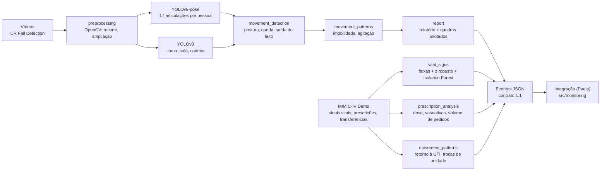
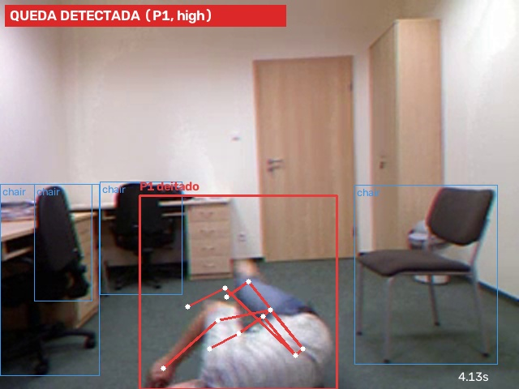

# Análise de vídeo e detecção de anomalias clínicas — Fase 4

Responsável: Vini.
Código: `src/video_analysis/` e `src/anomaly_detection/`. Integração: [arquitetura](fase4_arquitetura.md) ·
[contrato de eventos](fase4_contrato_eventos_v1.md).

> Protótipo acadêmico. Os resultados são **achados para avaliação profissional**, não
> diagnóstico nem conduta. Os limiares não foram validados clinicamente.

## 1. Visão geral



| Requisito do desafio | Onde está |
|---|---|
| Processar vídeos clínicos | `src/video_analysis/preprocessing.py`, `extraction.py` |
| Análise postural (OpenPose) | `src/video_analysis/pose.py` — YOLOv8-pose, mesmas 17 articulações COCO (ver seção 7) |
| YOLOv8 para objetos e áreas críticas | `src/video_analysis/objects.py` |
| Movimentos ou eventos fora do padrão | `src/video_analysis/movement_detection.py` |
| Relatórios automáticos de desvios | `src/video_analysis/report.py` → [exemplo](fase4_relatorio_video.md) |
| Anomalias em séries de sinais vitais | `src/anomaly_detection/vital_signs.py` |
| Evolução de prescrições | `src/anomaly_detection/prescription_analysis.py` |
| Padrões de movimentação na internação | `src/anomaly_detection/movement_patterns.py` |
| Alertas para a equipe | eventos no contrato → regras da integração (`src/monitoring/rules.py`) |

## 2. Datasets

| Dataset | Uso | Origem | Licença |
|---|---|---|---|
| **MIMIC-IV Clinical Database Demo 2.2** | sinais vitais (`icu/chartevents`), prescrições (`hosp/prescriptions`), transferências (`hosp/transfers`) | [PhysioNet](https://physionet.org/content/mimic-iv-demo/2.2/) — sugerido no enunciado | Open Database License v1.0, acesso aberto |
| **UR Fall Detection Dataset (URFD)** | os 70 clipes da câmera 0 (30 quedas e 40 atividades do dia a dia): 8 para ajustar os limiares, 62 para validar | [Universidade de Rzeszów](http://fenix.ur.edu.pl/~mkepski/ds/uf.html) | CC BY-NC-SA 4.0, uso acadêmico não comercial |

- **MIMIC-IV Demo:** 100 pacientes desidentificados do Beth Israel Deaconess Medical Center.
  Usamos 19.805 observações de sinais vitais de 140 internações em UTI, 18.087 prescrições e
  1.190 movimentações. As datas já vêm deslocadas para o futuro pela desidentificação.
- **URFD:** Kwolek B., Kepski M. *Human fall detection on embedded platform using depth maps
  and wireless accelerometer.* Computer Methods and Programs in Biomedicine, 117(3), 2014,
  489–501. Cada clipe traz profundidade e RGB lado a lado; usamos só a metade RGB (320x240,
  30 fps). Os 8 clipes de ajuste estão em `SAMPLE_CLIPS` (`preprocessing.py`); os outros 62
  formam o conjunto de validação e não participaram da calibração.
- Os arquivos baixados **não são versionados** (`data/clinical/raw/`, `data/video/raw/`,
  `models/` estão no `.gitignore`). O repositório traz os scripts de download e as saídas
  geradas. As duas imagens em `docs/img/` são quadros do URFD anotados pelo módulo e
  seguem a licença CC BY-NC-SA 4.0 do dataset.
- O URFD mostra quedas em ambiente doméstico, não vídeos de cirurgia ou fisioterapia. Foi
  escolhido por ser público, pequeno e conter o evento de maior risco no monitoramento de
  pacientes; as métricas de postura servem a outras cenas (seção 6).

## 3. Como executar

PowerShell, na raiz do projeto.

```powershell
py -m pip install -r requirements-fase4.txt -r requirements-fase4-video-clinico.txt

# Dados (uma vez): ≈ 6 MB do PhysioNet e ≈ 93 MB do URFD
py -m src.anomaly_detection.data_loader --download
py -m src.video_analysis.preprocessing --download --all   # sem --all: só os 8 clipes de ajuste, ≈ 10 MB

# Anomalias clínicas -> output/clinical/ (events.json, report.md, report.json)
py -m src.anomaly_detection.run
py -m src.anomaly_detection.run --profile ward          # limiares de enfermaria
py -m src.anomaly_detection.run --stream 30057454       # replay de uma internação, em tempo real
py -m src.anomaly_detection.evaluate                    # avaliação com anomalias injetadas

# Vídeo -> output/video/ (events.json, report.md, quadros e vídeos anotados)
py -m src.video_analysis.run --crop right --annotate
py -m src.video_analysis.run --crop right --from-cache  # reaplica as regras sem rodar os modelos

# Amostras para a integração e fluxo completo
py -m src.fase4_samples
py -m src.monitoring.workflow --input data/fase4_recebidos --summary-only

py -m pytest                                            # testes
```

Os pesos `yolov8n.pt` e `yolov8n-pose.pt` (≈ 13 MB) são baixados pela Ultralytics no
primeiro uso; se estiverem em `models/`, são usados dali. Não é preciso GPU.

Para outro vídeo: `py -m src.video_analysis.run --input caminho\video.mp4 --patient-id P0002
--recorded-at "2026-11-12T10:05:00-03:00"` (sem `--crop`, que só serve ao formato do URFD).

## 4. Análise de vídeo

**Pré-processamento.** OpenCV lê o vídeo, recorta a metade RGB e amplia quadros pequenos
para 480 px de altura, porque o estimador de pose perde articulações em pessoas com poucos
pixels.

**Extração.** Em cada quadro, o YOLOv8-pose devolve caixa e 17 articulações por pessoa; um
rastreador por sobreposição mantém a identidade de cada pessoa. A cada 10 quadros, o YOLOv8
detecta cama, sofá, cadeira e banco. Como a câmera é fixa e quem deita encobre a cama, as
detecções do clipe inteiro são reunidas em objetos estáveis (presentes em pelo menos 30%
dos quadros amostrados). O resultado fica em cache (`output/video/cache/`).

**Postura por quadro**, com filtro de maioria de 5 quadros:

| Postura | Critério |
|---|---|
| deitado | caixa larga (largura/altura ≥ 1,1), ou tronco a ≥ 55° da vertical com caixa ≥ 0,75 |
| em pé | caixa alta (≤ 0,6) e tronco a ≤ 30° |
| sentado/agachado/curvado | os demais casos |

A segunda condição de "deitado" exige caixa larga para não confundir com quem só se curva.

**Eventos.** As distâncias são divididas pela altura da pessoa em pé nos 3 s anteriores,
então os limites não dependem da distância até a câmera.

| Evento | Regra | Prioridade sugerida |
|---|---|---|
| `fall_detected` | passa a deitado fora de cama/sofá, e a parte superior do corpo desceu ≥ 0,45 altura de corpo com pico ≥ 0,7 altura/s | `high`; `critical` se depois ficar imóvel ≥ 2 s |
| `prolonged_immobility` | deitado e parado: ≥ 2 s fora do leito, ≥ 2 h no leito | `high` / `medium` |
| `agitation` | movimento intenso dos membros por ≥ 4 s, sem deslocamento pelo ambiente | `medium` |
| `bed_exit_attempt` | estava deitado no leito ≥ 1 s e fica em pé ou sai da área do leito | `high` / `medium` |
| `video_check` | nenhum dos anteriores | sem anomalia |

"Área crítica" é o chão: a mesma postura deitada é esperada sobre a cama (objeto detectado
pelo YOLOv8) e vira achado fora dela.

**Relatório automático.** `report.md` e `report.json` listam, por vídeo, pessoas rastreadas,
objetos da cena, distribuição de posturas e cada desvio com instante, métricas e
confiança. Cada achado gera um quadro anotado; `--annotate` grava o vídeo anotado.



*Quadro anotado pelo módulo: esqueleto e caixa da pessoa, cadeiras detectadas e aviso.*

## 5. Detecção de anomalias clínicas

### 5.1 Sinais vitais

Quatro camadas avaliam cada observação (FC, FR, SpO2, PAS e temperatura):

| Camada | Técnica | Dispara quando |
|---|---|---|
| `faixa_referencia` | pontuação por faixas inspirada no NEWS2 | escore ≥ limiar, ou um sinal com 3 pontos (perfil `ward`) |
| `desvio_individual` | z robusto (mediana e MAD) contra as 12 últimas observações do paciente | \|z\| ≥ 3,5 e variação mínima (ex.: 20 bpm) |
| `padrao_multivariado` | Isolation Forest (200 árvores, contaminação 2%) sobre FC, FR, SpO2, PAS e FC/PAS | escore negativo |
| `tendencia` | aumento do escore nas últimas 3 observações | sobe ≥ 3 pontos (`ward`) ou ≥ 4 (`icu`) |

- O escore é **parcial**: não usa nível de consciência nem oxigênio suplementar.
- **Tempo real:** `VitalSignsMonitor.update()` avalia uma observação por vez, guardando só o
  estado recente do paciente. `--stream` reapresenta uma internação nesse modo.
- **Episódios:** um episódio anômalo gera evento no início, quando a prioridade sobe e, se
  persistir, a cada 2 h. As demais observações são suprimidas.
- **Perfis:** `ward` usa os limiares do NEWS2 (5 e 7). `icu` usa 7 e 9 e ignora o sinal
  isolado, porque o paciente de UTI já parte de um escore alto.
- **Prioridade sugerida:** escore ≥ limiar alto → `high`; camada de faixas → `medium`; só
  sinal estatístico → `low`. Faixas mais um sinal estatístico sobem um nível.
- Valores implausíveis (ex.: PAM 801 mmHg, FC 0) são descartados como artefato. A pressão
  invasiva tem preferência sobre a não invasiva.

### 5.2 Prescrições

| Detector | O que aponta |
|---|---|
| `dose_change` | dose do mesmo medicamento, via e unidade muda ≥ 3x (ou ≥ 5x em insulina, varfarina e vancomicina, que são tituladas por protocolo) |
| `atypical_dose` | dose ≥ 5x a mediana da população para o mesmo medicamento e via (z robusto em escala log) |
| `vasoactive_start` | início de droga vasoativa, ou associação de um segundo agente |
| `order_burst` | novos pedidos em 6 h muito acima do padrão da própria internação, depois das primeiras 24 h |

Diluentes e soluções de manutenção ficam fora. Medicamentos de alta vigilância (lista
resumida inspirada no ISMP) sobem a prioridade.

### 5.3 Padrões de movimentação

- **Atividade corporal (vídeo):** imobilidade prolongada e agitação, a partir do
  deslocamento das articulações (`detect_activity_patterns`).
- **Movimentação entre unidades (MIMIC-IV):** retorno à UTI entre 1 h e 72 h depois da
  saída, e 3 trocas de unidade em menos de 24 h.

## 6. Resultados

Executado em 16/11/2026, em CPU, Python 3.14.

### 6.1 Vídeo

Os limiares foram ajustados em 8 clipes e depois **congelados**. Os outros 62 clipes do
dataset foram processados uma única vez, sem nenhum ajuste posterior: é a medida
independente de desempenho.

| Conjunto | Vídeos | Quedas detectadas | Falsos alarmes de queda | Sensibilidade | Especificidade |
|---|---|---|---|---|---|
| Ajuste | 8 | 4 de 4 | 0 de 4 | 100% | 100% |
| **Validação** | **62** | **22 de 26** | **2 de 36** | **84,6%** | **94,4%** |
| Todos | 70 | 26 de 30 | 2 de 40 | 86,7% | 95,0% |

Acurácia na validação: 90,3%. Foram processados 11.936 quadros em 306 s (≈ 39 quadros/s),
acima dos 30 fps de gravação.

Os seis erros da validação, um a um:

| Clipe | Erro | Causa |
|---|---|---|
| `fall-08`, `fall-12` | queda não detectada | queda lenta a partir da cadeira: pico de 0,62 e 0,57 altura/s, abaixo do limite de 0,7 |
| `fall-20` | queda não detectada | queda da cadeira com descida de 0,44 altura de corpo, logo abaixo do limite de 0,45; a pessoa termina meio sentada |
| `fall-21` | queda não detectada | queda na direção da câmera: a pessoa sai do enquadramento, a pose se perde (43 de 55 quadros) e a postura deitada nunca é observada |
| `adl-38`, `adl-39` | falso alarme | a pessoa deita no chão de propósito, rápido o bastante (pico de 0,79 e 0,71) para passar pela regra de queda; como fica parada, a prioridade sobe para `critical` |

- **Quedas a partir da posição sentada são o ponto fraco:** 3 das 4 quedas não detectadas.
  O conjunto de ajuste tinha uma só (`fall-22`).
- **A margem é estreita:** entre as quedas detectadas na validação, o menor pico de
  velocidade foi 0,70 altura/s, exatamente o limite.
- Além dos dois falsos alarmes de queda, `adl-32` gerou `prolonged_immobility`: a pessoa
  deita devagar no chão e fica parada. É o comportamento desejado da regra, mas num clipe
  de atividade normal. Ao todo, 3 de 36 atividades normais geraram algum aviso.
- As atividades normais incluem os casos parecidos com queda: agachar, curvar-se, sentar
  e deitar na cama. Deitar na cama detectada pelo YOLOv8 não gera alarme.
- Agitação e saída do leito não ocorrem nos clipes e foram verificadas só com poses
  sintéticas (testes).
- Os limiares não foram reajustados depois da validação: fazer isso transformaria os 62
  clipes em conjunto de ajuste e deixaria o módulo de novo sem medida independente.

Relatório completo: [fase4_relatorio_video.md](fase4_relatorio_video.md).

### 6.2 Dados clínicos (MIMIC-IV Demo, perfil `icu`)

| Medida | Valor |
|---|---|
| Observações de sinais vitais | 19.805 (505 pacientes-dia) |
| Valores descartados como artefato | 78 |
| Observações anômalas | 3.203 (16,2%) |
| Eventos emitidos | 1.871 (3,7 por paciente-dia) |
| Suprimidas por episódio já avisado | 1.332 |
| Eventos por prioridade | 107 `critical`, 314 `high`, 298 `medium`, 1.152 `low` |
| Alterações de prescrição | 566 em 136 internações: 372 mudanças de dose, 102 vasoativos, 61 doses atípicas, 31 picos de pedidos |
| Padrões de movimentação | 9: 7 retornos à UTI, 2 trocas frequentes |

Com o perfil `ward`, 42,3% das observações ficam anômalas (7,5 eventos por paciente-dia):
os limiares de enfermaria não servem a uma população de UTI. Relatório completo:
[fase4_relatorio_clinico.md](fase4_relatorio_clinico.md).

### 6.3 Avaliação com anomalias injetadas

O MIMIC-IV não tem rótulo de anomalia. `evaluate.py` gera 200 pacientes sintéticos estáveis
(72 h cada) e injeta em 99 deles um episódio conhecido.

| Intensidade do episódio | Sensibilidade `ward` | Sensibilidade `icu` | Falsos positivos `ward` / `icu` |
|---|---|---|---|
| 1,0 (completo) | 100% | 100% | 3,6% / 3,0% |
| 0,6 | 98,0% | 97,0% | 3,6% / 3,0% |
| 0,4 | 76,8% | 73,7% | 3,6% / 3,0% |

O atraso médio fica abaixo de 1,1 observação. Com episódios discretos, bradicardia é o mais
difícil (50%). É um teste de funcionamento: episódios sintéticos são mais limpos que os reais.

### 6.4 Exemplos de anomalias detectadas

- **Sinais vitais, `critical`** (paciente 10002495): "FC 133 bpm, FR 27 irpm, SpO2 84 %,
  PAS 71 mmHg. Escore parcial inspirado no NEWS2: 12. Desvio do padrão individual: SpO2 -13 %
  em relação à mediana recente (97). Combinação de sinais atípica para a população (Isolation
  Forest). Piora rápida: escore subiu 6 pontos."
- **Prescrição, `critical`** (mesmo paciente e horário): "Associação de novo vasoativo
  (PHENYLEPHrine) a esquema que já incluía dopamine."
- **Prescrição, `high`**: "Dose de HYDROmorphone (Dilaudid) (IV) de 20 mg, 40.0x a mediana
  de 246 pedidos do mesmo medicamento (0.5 mg)."
- **Movimentação, `high`**: "Retorno à terapia intensiva (Surgical Intensive Care Unit
  (SICU)) 42 h depois da saída para Med/Surg."
- **Vídeo, `high`** (`fall-01`): "Descida rápida seguida de postura deitada fora de cama ou
  sofá: parte superior do corpo desceu 0.93 altura de corpo em 1.5 s (pico de 1.3 alturas/s)."

Saídas versionadas: `data/fase4_vini/video_events_urfd.json` (70 clipes),
`data/fase4_vini/video_evaluation_urfd.json` (resultado por clipe e por conjunto) e
`data/fase4_vini/clinical_events_P10002495.json` (internação inteira, 31 eventos).

### 6.5 Integração

`py -m src.fase4_samples` gera `data/fase4_recebidos/P0001_video.json` e
`P0001_clinical.json`, que substituem os exemplos fictícios.

O paciente `P0001` do teste conjunto é **composto**: o vídeo é o clipe `fall-01` do URFD e
os dados clínicos são do paciente 10002495 do MIMIC-IV, com os horários deslocados para a
janela combinada (12/11/2026, 10:00–10:15, `-03:00`). Demonstra a fusão das modalidades com
saídas reais dos módulos, não um caso clínico único.

Resultado do fluxo (`RUN-recebidos-vini`, relatório em
[fase4_exemplo_relatorio_integrado.json](fase4_exemplo_relatorio_integrado.json)):

| Verificação | Resultado |
|---|---|
| Eventos | 4 recebidos, 4 aceitos, 0 rejeitados |
| Grupo | `P0001@2026-11-12T13:00:00Z`, fontes `audio, video, clinical` |
| Anômalos | `fall_detected` (vídeo), `vital_signs` e `prescription_change` (clínico) |
| Alerta | `ALT-95adc1a4ce34`, `critical`, `pending_medical_review` |
| Regras | R1 (prioridade `critical` do módulo clínico), R2 (queda), R3 (vídeo e clínico) |

## 7. Decisões técnicas

- **YOLOv8-pose no lugar do OpenPose.** O OpenPose exige compilação ou binários próprios e
  modelos de ≈ 200 MB. O YOLOv8-pose entrega as mesmas 17 articulações COCO, instala com
  `pip` e roda em tempo real em CPU. As regras dependem só das articulações
  (`Observation`), então outra fonte de pose pode ser ligada sem mudar o restante.
- **Regras explícitas em vez de classificador treinado.** O dataset tem 70 clipes curtos,
  pouco para treinar e validar um classificador. As regras deixam claro por que um evento foi emitido (descida e velocidade
  medidas), o que ajuda a revisão humana.
- **Camadas independentes nos sinais vitais.** Faixas fixas pegam valores perigosos; o
  desvio individual pega mudanças dentro da faixa; o Isolation Forest pega combinações
  atípicas. Cada evento informa quais camadas dispararam.
- **Contrato 1.1.** Prescrições e movimentações não cabiam nos tipos da versão 1.0. Foram
  acrescentados `prescription_change`, `patient_transfer` e a evidência `prescription`;
  eventos 1.0 continuam válidos.

## 8. Testes

`py -m pytest` — 153 testes aprovados, 97 deles destes módulos:

| Arquivo | Cobre |
|---|---|
| `tests/test_vital_signs.py` | faixas, desvio individual, episódios, perfis, modelo, lote x tempo real, carga dos dados |
| `tests/test_prescription_analysis.py` | os quatro detectores de prescrição e as movimentações entre unidades |
| `tests/test_video_analysis.py` | postura, queda, leito, imobilidade, agitação, rastreador, objetos, relatório |
| `tests/test_vini_outputs.py` | contrato 1.1, saídas versionadas e fluxo de integração |

Os testes de vídeo usam poses sintéticas e não precisam dos vídeos nem dos modelos. Sem
`numpy`, `pandas` ou `scikit-learn` instalados, os testes que dependem deles são pulados.

## 9. Limitações

- **Vídeo:** na validação, 4 de 26 quedas não foram detectadas, 3 delas a partir da
  posição sentada, e deitar no chão de propósito gerou 2 falsos alarmes. Uma câmera, uma
  cena por clipe, boa iluminação, ambiente doméstico. Oclusão, várias pessoas próximas e
  câmera em movimento não foram testadas. Queda na direção da câmera pode tirar a pessoa
  do enquadramento. Se a cama não for detectada, deitar rápido pode virar falso alarme.
- **Sinais vitais:** no MIMIC-IV as medidas são horárias, então "tempo real" aqui é a
  decisão a cada observação, não um fluxo de alta frequência. O escore parcial ignora
  consciência e oxigênio. Paciente crônico com valores sempre alterados gera avisos de
  persistência a cada 2 h. O Isolation Forest foi treinado e aplicado na mesma população.
- **Prescrições:** não avalia indicação, interação, função renal nem dose por peso.
  Titulação planejada aparece como mudança abrupta: dos 566 achados, 372 são mudanças de
  dose, e a maioria tende a ser ajuste esperado. Vasoativo em pós-operatório cardíaco é rotina.
- **Falsos positivos medidos:** 3,0% das observações normais sintéticas no perfil `icu`.
  No MIMIC-IV não há como medir, por falta de rótulo.
- **Dados:** URFD é ambiente doméstico; MIMIC-IV é UTI de um único hospital dos EUA.
